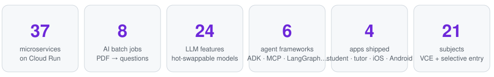
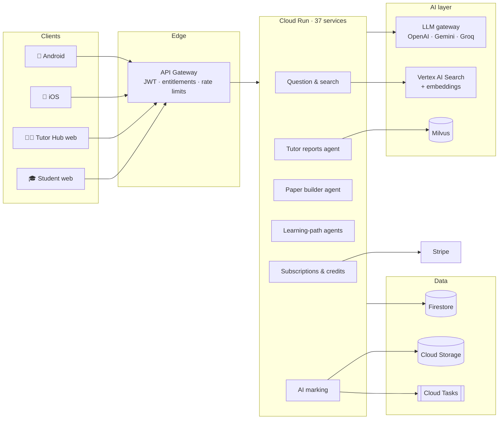
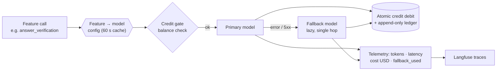
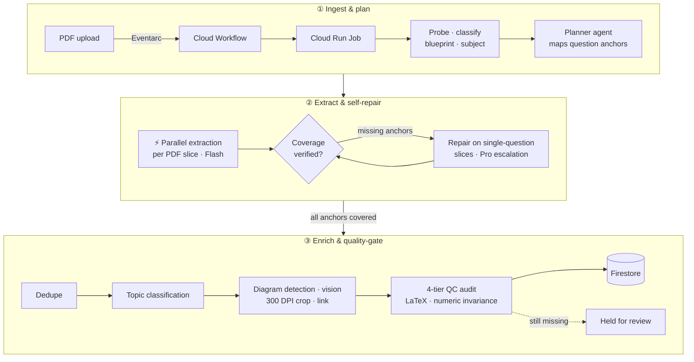
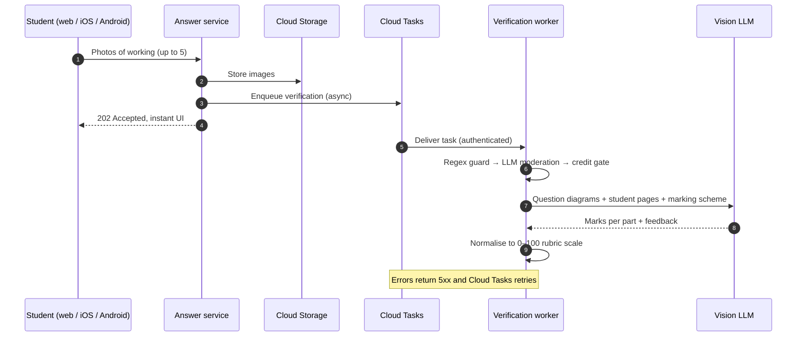
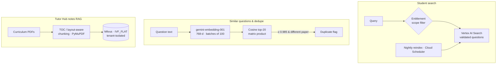
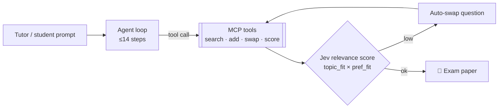

# Hi, I'm Srikant 👋

**Co-founder, [Excelerate Education](https://www.excelerateme.com.au)** · AI engineering · Full-stack · Australia

I build production AI systems for real users: vision and document intelligence, RAG, agentic workflows, and the LLM operations around them (cost, routing, telemetry, evaluation), delivered across web, iOS and Android.

> 🔒 Most of my work is commercial and lives in private repos. The diagrams below describe the real systems. **I'm happy to walk through the code live or give a reviewer temporary read access.**

---

## 🏗️ ExcelerateMe: the platform

An AI exam-practice and tutoring platform for VCE and selective-entry students. It is live at **[excelerateme.com.au](https://www.excelerateme.com.au)** and has paid subscriptions. I co-founded it with Bipin Mehta and have made **470+ commits** across the AI, backend and infrastructure.

---

## 🧠 LLM gateway: many models, one interface

I don't depend on a single vendor. One shared gateway exposes **24 named AI features**, and each feature is assigned a model through Firestore config. That config is re-read every 60 s, so I can **swap or A/B-test models in production without a redeploy**.

| Workload | Models | Why |
|---|---|---|
| Answer marking, generation, notes | **GPT-5.4-mini** primary → **Gemini 3 Flash** fallback | Quality per dollar, with a second vendor for resilience |
| Vision: handwriting, diagrams, PDFs | **Gemini Flash** (Vertex), **Gemini Pro** for escalation only | Multimodal at scale; Pro used only where Flash fails |
| Bulk classification / tagging | **Groq gpt-oss-120b** · **Llama 4 Scout** via the **Batch API** | Sub-second inference; batch is about 50% cheaper |
| Embeddings | **gemini-embedding-001** (768-d) · fastembed MiniLM | Similar-question search and duplicate detection |
| Relevance scoring | **TypeSafe Jev** | Typed judgement scores that keep generated papers on topic |
| Document layout | **Azure Document Intelligence** · **Google Document AI** | Figure cropping and page classification |

---

## 📄 Document intelligence: turning exam PDFs into structured questions

Exam papers are full of LaTeX, diagrams and nested parts (a → i, ii). A 16-stage, event-driven pipeline turns them into curriculum-tagged questions with quality scores.

**Engineering details**
- 🎯 **Coverage check, then repair:** after extraction, the expected question anchors are compared against the output. Gaps are re-extracted on single-question slices using the stronger model.
- 🔢 **Numeric invariance check:** catches the LLM silently changing numbers when it rewrites LaTeX.
- 🧯 **Self-healing runs:** a reconciler runs every 5 minutes and fails any run whose heartbeat has gone stale. Curriculum mappings go to a proposals collection first, can be promoted with `--execute`, and can be rolled back.
- 🧾 **OMR + handwriting:** reads scanned answer sheets and photos of student working, matched to each question part.

---

## ✍️ AI marking of handwritten work

---

## 🔎 RAG and search

---

## 🤖 Agentic workflows

Agents run the most critical flows, each with **hard guardrails**.

| Agent system | Framework | What it does | Guardrails |
|---|---|---|---|
| **Paper Builder ("Build with AI")** | MCP server (12 tools) + custom tool loop | Builds a full exam paper from a conversation | Max 14 steps / 30 turns · JWT + entitlement checks · **the model never sees answers or IDs** · up to 4 auto-repair quality rounds |
| **Learning-path planner** | Google ADK · **9 agents** | Goal intake → diagnostic → curriculum map → plan → validate → coach → adapt | Plan-validator agent checks the plan before it is shown |
| **Exam-intelligence agent** | Google ADK on Vertex Agent Engine | Analyses past papers end to end with about 30 tools | Idempotency keys · switches to the other extraction method if one returns nothing |
| **Tutor report agent** | LangChain + MCP adapters → **FastMCP (30 tools)** | Natural-language reports on student performance | Tool set limited per scope · PII redaction · prompt-injection filters |
| **Study-notes crew** | CrewAI · 10 roles | Researcher → author → reviewer → image reviewer → formatter | Reviewer stages before publishing |
| **Extractor v1** | LangGraph + DSPy | Extraction graph with a quality-check → retry loop | DSPy-optimised prompts |

---

## 💰 AIOps: cost and performance

| Lever | Implementation | Impact |
|---|---|---|
| **Model tiering** | Flash by default, Pro only for repair | about 80% cheaper and 3× faster per extraction |
| **Batch inference** | Groq Batch API for tagging (4.2k questions in 212 requests) | about 50% off bulk jobs |
| **Caching** | MCQ explanations cached on question docs · quality results keyed by content fingerprint · embeddings reused when text is unchanged | No repeat calls for the same content |
| **Credits metering** | SDK-level wrappers debit every OpenAI / Gemini / Groq call atomically, with a ledger | Per-user cost control that can be audited |
| **Pricing table** | Per-model USD/token in YAML, cost computed per call, unpriced models flagged | Real-time unit economics |
| **Rate limiting** | Firestore fixed-window limiter shared across Cloud Run instances (fails open) | Abuse protection without Redis |
| **Async everything** | Cloud Tasks for marking · bounded concurrency (12 parallel, 10 s / 25 s timeouts) | Fast UI, predictable latency |
| **Scale to zero** | Cloud Run min 0 / max 3 for most services | Pay only for traffic |
| **Observability** | Langfuse traces + OpenInference · background telemetry writer (tokens, latency, cost, fallback) | Every LLM call can be traced |
| **Delivery** | 17 multistage Dockerfiles · dev → UAT → prod on separate GCP projects · Expo EAS for mobile | Safe, repeatable releases |

---

## 📱 Apps

| | Student web | Tutor Hub | iOS | Android |
|---|:-:|:-:|:-:|:-:|
| Stack | Python services + JS | FastAPI + Jinja | React Native · Expo | React Native · Expo |
| AI | Marking, search, paper builder, learning paths | Exams, AI notes, report agent | Photo marking, practice | Photo marking, practice |
| Status | ✅ Live | ✅ Built · in UAT | 🚀 App Store submitted (Oct 2026) | ✅ Built |

Also: 🎬 an **automated reels pipeline** (Remotion + neural TTS) that turns a single data file into a narrated, word-synced Instagram Reel explaining a worked exam solution.

---

## 🛠️ AI-native engineering workflow

| Tool | How I use it |
|---|---|
| **Claude Code** | Main coding agent. Project `CLAUDE.md`, custom skills (input-guard, integration, video pipeline), MCP servers wired in. **120+ AI-co-authored commits** |
| **Cursor** | Project rules (`.cursor/rules`) and skills for editing in the IDE |
| **Antigravity** | Agent-first IDE for parallel tasks |

---

## 🧪 Other projects

- **FlickRole:** swipe-based job discovery for Australia. Native **Swift** iOS and **Kotlin** Android apps on **Supabase**. [Site](https://github.com/tallaprs15/flickrole-site)
- **[Agentic AI builder course](https://github.com/tallaprs15/nebius-agentic-ai-builder-course)** · Google ADK and OpenAI Agents experiments · LLM fine-tuning
- Earlier: Terraform/AWS infrastructure as code, CI/CD pipelines, and a [Flask API tutorial](https://github.com/tallaprs15/python-flask-api-tutorial)

---

