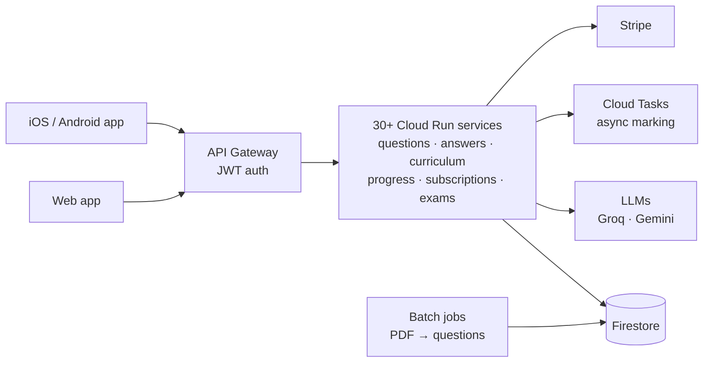

# Hi, I'm Srikant 👋

**Co-founder, [Excelerate Education](https://www.excelerateme.com.au)** · AI products · Full-stack engineering · Australia

I turn messy real-world problems into AI products that people actually use. I co-founded and run a live education business, taking it from a blank page to paying users. That meant working out what students, tutors and schools needed, deciding what to build first, and then building it myself: data pipelines, LLM systems, cloud infrastructure, web and mobile apps.

### How I work
- **Start from the problem, not the model.** I sit with users (students, tutors, schools), find the workflow that's actually broken, and design around it.
- **Prototype fast, then make it hold up in production.** I work in clickable prototypes and quick experiments first, then build the version that handles payments, edge cases and scale.
- **Make AI trustworthy.** That means scoring layers, rubrics and verification steps, so the output can be relied on in front of real customers.
- **Handle the unglamorous parts of shipping:** user acceptance testing with real users, App Store review, payments and entitlements, content licensing, and monitoring.

Most of my work is commercial and kept in **private repositories**, so it doesn't appear below. This page summarises it. **I'm happy to walk through the code live or give a reviewer temporary read access on request.**

---

## 🚀 ExcelerateMe: AI exam-practice platform (VCE and selective entry)

🌐 **[excelerateme.com.au](https://www.excelerateme.com.au)** · ✍️ [Engineering blog](https://excelerateeducation.substack.com)

**The problem:** students preparing for high-stakes exams get little timely feedback, and tutors can't mark at scale. Good practice material is locked inside past-paper PDFs.

**What we built:** a live, paid platform where Victorian students practise past-exam style questions, get them marked by AI (including photos of handwritten working), and follow personalised study paths. I co-founded it with Bipin Mehta and am one of its two main engineers. I've made **470+ commits since May 2025** across the backend, AI pipelines, frontend and deployment.

**Scale of the system**
- **30+ microservices** (Flask/FastAPI) on **Google Cloud Run**, behind an API gateway with JWT auth
- **8 batch jobs** for extracting, classifying and curating questions from exam PDFs
- **Firestore** as the database, **Secret Manager** for credentials, **Stripe** for subscriptions and credits, **Twilio** for WhatsApp

**Things I built that I'm proud of**
- **AI marking pipeline.** Groq (Llama) handles the fast path and Gemini handles vision and fallback. Photos of handwritten working are mapped to the right question part and then verified asynchronously through Cloud Tasks. Writing tasks are scored against a 0–100 rubric.
- **AI Paper Generator.** It assembles full practice exams for VCE and selective-entry tests from a curriculum. A scoring layer keeps the generated questions on topic ([blog post](https://excelerateeducation.substack.com)).
- **VCE exam runner.** Timed, exam-faithful papers. Answers are revealed only after the student locks in a response and are never included in the page sent to the browser.
- **Question-extraction pipeline.** Turns past-paper PDFs into structured, curriculum-tagged questions with LaTeX maths and nested sub-questions (a → i, ii).
- **Cognitive-engagement features.** A hint ladder, Socratic multiple-choice questions, and study notes that teach the method rather than give away the solution, designed so students think instead of copying.
- **MCP servers** (`paper-mcp`, `curation-mcp`) that expose the platform to AI agents.

`Python` `FastAPI` `Flask` `Google Cloud Run` `Firestore` `Docker` `Cloud Build` `Groq` `Gemini` `Stripe` `JavaScript` `MathLive/LaTeX`

---

## 📱 ExcelerateMe mobile app (iOS and Android)

A **React Native + Expo** (TypeScript) companion app. It includes passwordless and Google sign-in, offline-capable practice with SQLite, photo submission of handwritten working, and push notifications. **Submitted to the Apple App Store in October 2026.** I worked on the backend integration, the release pipeline (EAS builds, App Store Connect) and preparing it for App Store review.

`React Native` `Expo` `TypeScript` `TanStack Query` `SQLite` `EAS`

---

## 🧑‍🏫 Excelerate Tutor Hub: AI platform for teachers

A multi-tenant SaaS for tutors and schools. It covers question banks, AI-generated exams and study notes (with vector search over curricula), class management, and student performance reports.

`FastAPI` `Jinja` `Milvus` `Docker` `GCP`

---

## 🎬 Automated reels pipeline

A **Remotion** pipeline that turns one data file into a narrated Instagram Reel explaining a worked exam solution. It generates a neural voice-over, aligns captions word by word, renders the cover and subtitles, and drafts the post caption.

`Remotion` `React` `TypeScript` `edge-tts` `ffmpeg`

---

## 🧪 Other projects

- **FlickRole.** Swipe-based job discovery for Australia, with native iOS (Swift) and Android (Kotlin) apps on a Supabase backend. [Site repo](https://github.com/tallaprs15/flickrole-site)
- **Question-bank builder agent.** An agent that builds curriculum-aligned question banks.
- **[Agentic AI builder course](https://github.com/tallaprs15/nebius-agentic-ai-builder-course).** Coursework on building agentic AI systems.
- Earlier: Terraform/AWS infrastructure as code, CI/CD pipelines, and a [Flask API tutorial](https://github.com/tallaprs15/python-flask-api-tutorial).

---

## 🛠️ Toolbox

**Languages:** Python · TypeScript/JavaScript · Swift · Kotlin · SQL
**Backend and cloud:** FastAPI · Flask · Google Cloud Run · Firestore · Cloud Tasks · Supabase · Docker · Terraform · AWS
**AI:** Gemini · Groq/Llama · OpenAI · Claude · MCP servers · agent frameworks (Google ADK, OpenAI Agents) · vector search · fine-tuning
**Frontend and mobile:** React · React Native/Expo · Swift · Kotlin · Remotion

---

📫 **Contact:** [LinkedIn](https://www.linkedin.com/in/stallapragada/) · srikant.t@gmail.com
