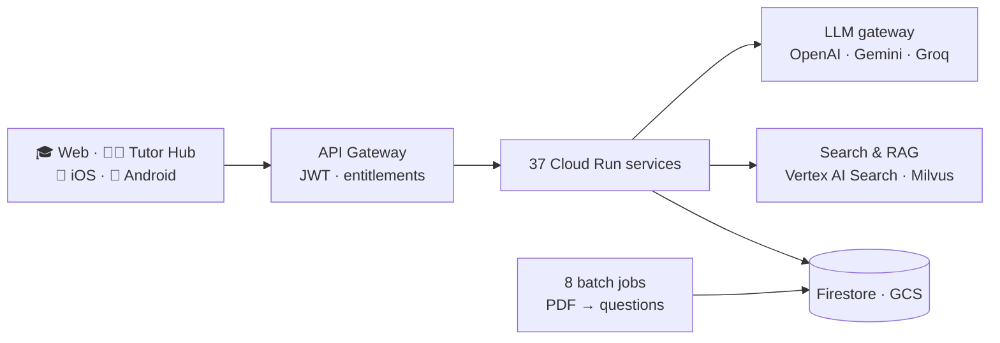

# Hi, I'm Srikant 👋

**Co-founder, [Excelerate Education](https://www.excelerateme.com.au)** · AI engineering · Full-stack · Australia

I build production AI systems for real users: document and vision intelligence, RAG, agentic workflows, and the LLM operations around them (routing, cost, telemetry, evaluation), delivered across web, iOS and Android.

> 🔒 Most of my work is commercial and lives in private repos. **I'm happy to walk through the code live or give a reviewer temporary read access.**

---

## 🚀 Key projects

| Project | What it is | Built with | Status |
|---|---|---|---|
| **[ExcelerateMe](https://www.excelerateme.com.au)** | AI exam-practice platform for VCE and selective-entry students: AI marking of handwritten work, an exam-paper generator, personalised learning paths. I co-founded it and am one of its two main engineers (470+ commits). | Python microservices on Cloud Run · Gemini · OpenAI · Groq · Firestore · Stripe | ✅ Live, paid |
| **ExcelerateMe mobile** | iOS and Android companion app: practice, photo submission of working, offline sync, push notifications. | React Native · Expo · TypeScript · SQLite | 🚀 App Store submitted |
| **[Excelerate Tutor Hub](https://www.tutorhub.excelerateme.com.au/)** | AI platform for tutoring organisations and schools: question banks, AI-generated exams and study notes, natural-language performance reports. | FastAPI · Milvus · LangChain + MCP · CrewAI | ✅ Live |
| **[Agent a Day](https://github.com/tallaprs15/agent-a-day)** | A new open-source AI agent every day, built with Google ADK on public MCP servers. Every agent has guardrails, a cost meter and tests, and they're all evaluated live every night on a [public dashboard](https://tallaprs15.github.io/agent-a-day/). | Google ADK · Gemini · MCP · GitHub Actions |  |
| **[CCAR-P study guide](https://github.com/tallaprs15/ccar-p-study)** | Free, open study notes and interactive practice exams for the Claude Certified Architect – Professional exam, including a timed 63-item full-length paper. | VitePress · Vue · TypeScript | ✅ [Live site](https://ccar-p-study.netlify.app/) |
| **Explainer reels pipeline** | Turns one data file into a narrated, caption-synced short video that explains a worked exam solution. | Remotion · React · neural TTS · ffmpeg | ✅ Working |
| **[FlickRole](https://github.com/tallaprs15/flickrole-site)** | Swipe-based job discovery for Australia, with a feed that learns on the device (Bayesian learning-to-rank) and AI resume import. | SwiftUI · Jetpack Compose · Supabase · Gemini | 🚀 App Store submitted |

---

## 🏗️ ExcelerateMe at a glance

## 🧠 AI engineering highlights

- **Multi-model LLM gateway.** 24 AI features, each mapped to a model in config, so I can swap or A/B-test models in production without a redeploy. Automatic fallback across vendors, per-call cost tracking and Langfuse tracing.
- **Document intelligence.** An event-driven pipeline turns exam PDFs (LaTeX, diagrams, nested parts) into structured, curriculum-tagged questions. It checks that every question was captured, repairs gaps with a stronger model, and runs a QC audit.
- **Vision marking.** Photos of handwritten working are marked against marking schemes asynchronously (Cloud Tasks), with moderation and credit checks first.
- **RAG and search.** Vertex AI Search filtered to what each student has paid for, embedding-based duplicate detection, and tenant-isolated Milvus retrieval for tutors.
- **Agents with guardrails.** An MCP-based exam-paper builder, a 9-agent learning-path planner (Google ADK), and a tutor reporting agent with PII redaction.
- **Cost control.** Cheap models by default with escalation only when needed, batch APIs, caching, atomic per-user credit metering, and scale-to-zero infrastructure.

Day to day I build with **Claude Code**, **Cursor** and **Antigravity**.

Earlier work: Terraform/AWS infrastructure as code, CI/CD pipelines · [Agentic AI course](https://github.com/tallaprs15/nebius-agentic-ai-builder-course) · [Flask API tutorial](https://github.com/tallaprs15/python-flask-api-tutorial)

---

